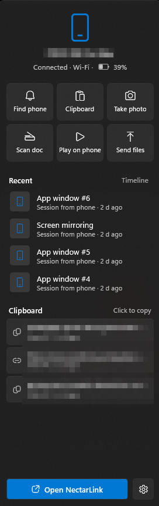

# Phone panel for NectarLink

A [Windhawk](https://windhawk.net) mod that shows a NectarLink-paired Android phone in the
Windows 11 Start menu, in the side panel Phone Link normally uses.

> **Unofficial.** This mod is not affiliated with or endorsed by NectarLink. It is compatible
> with [NectarLink](https://github.com/thtbee/nectarlink) and talks only to its local API.

## Requirements

- Windows 11 with Windhawk installed (x64)
- NectarLink installed and paired with your phone
- NectarLink → Settings → Local automation API turned on
- Windows Settings → Personalization → Start → "Show mobile device in Start" turned on

## Install

Open Windhawk, create a new mod, paste the contents of `phone-panel-for-nectarlink.wh.cpp`,
then compile and enable it.

## Privacy

The mod only connects to `127.0.0.1`. Nothing leaves your PC.

## Maintaining

See [DEVELOPMENT.md](DEVELOPMENT.md) for how the mod works, decisions to keep, and known gotchas.
Start's XAML element names can change with Windows updates; retest after each one.

## License

MIT, see [LICENSE](LICENSE).
